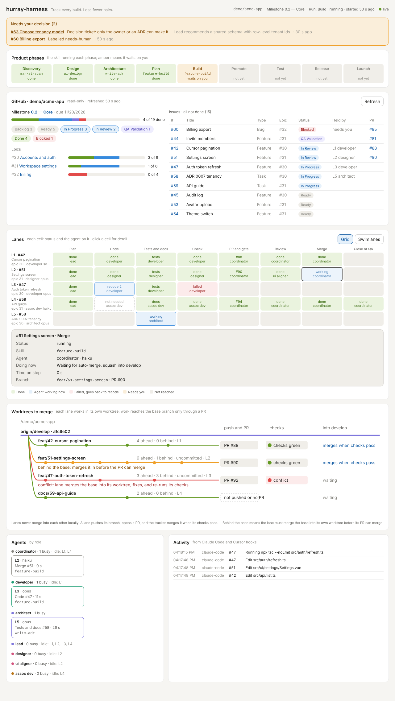
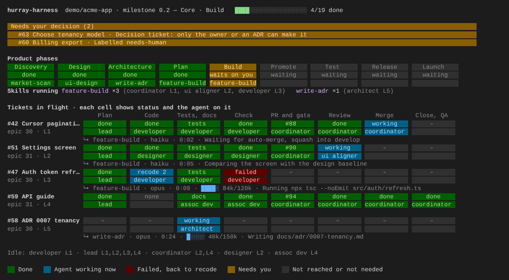
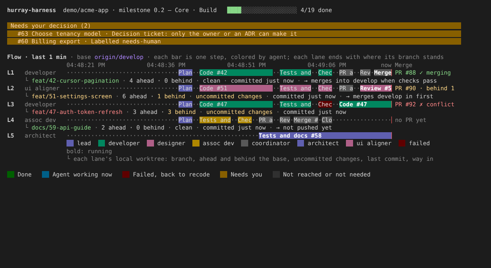
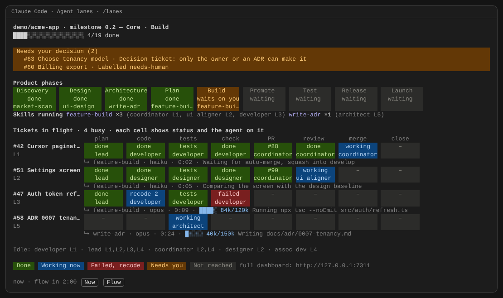
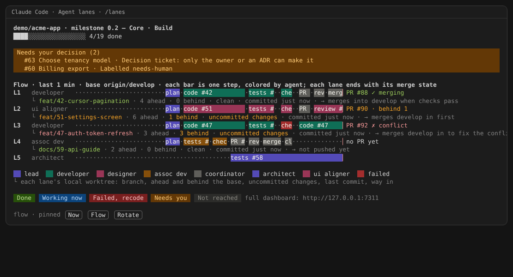
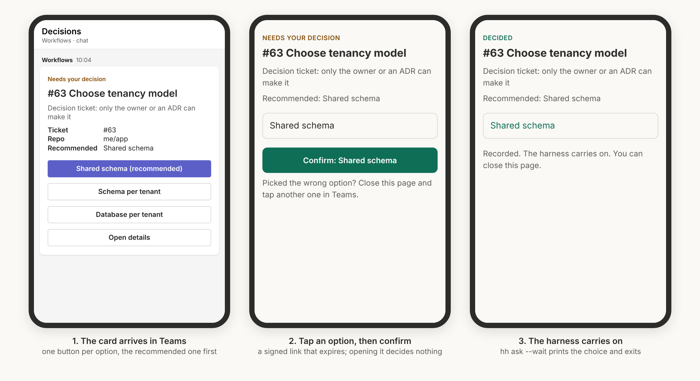
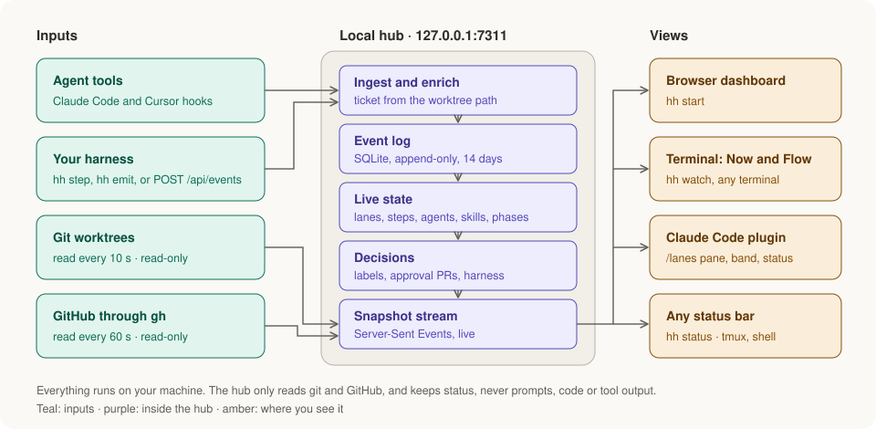

<h1 align="center">hurray-harness</h1>

<p align="center"><strong>Track every build. Lose fewer hairs.</strong></p>

<p align="center">
A live view of AI agents building your product: which lane is on which ticket, what each agent is doing right now, which skill it runs, where every worktree stands on its way to a merge, and what is waiting on you.
</p>

<p align="center">
<a href="#try-it-in-one-minute">Try it</a> ·
<a href="#install">Install</a> ·
<a href="#use-it-on-your-repo">Use it</a> ·
<a href="#inside-claude-code">Claude Code</a> ·
<a href="#connect-your-agents">Connect agents</a> ·
<a href="#decide-from-your-phone">Teams</a> ·
<a href="#how-it-works">How it works</a> ·
<a href="https://narasimhaponnada.github.io/hurray-harness/">Website</a>
</p>

<picture>
  <source media="(prefers-color-scheme: dark)" srcset="docs/dashboard-dark.png">
  
</picture>

## Why

When several AI agents build in parallel, each in its own git worktree, you lose the thread fast. Which lane is stuck in a recode loop? Which agent is burning its budget? Which branch has fallen behind or hit a conflict? And what has been waiting on your decision for twenty minutes?

hurray-harness answers those questions in one live view. It works with **any harness** and **any agent tool** (Claude Code, Cursor, or anything that can run a command or send JSON). It **only reads** git and GitHub, and it runs **entirely on your machine**.

## One view, three places

Use whichever fits how you work. All three read the same local hub, so they always agree.

| Where | Start it | Best for |
|---|---|---|
| **Browser** | `hh start`, then open http://127.0.0.1:7311 | The full picture on a second screen |
| **Any terminal** | `hh watch` | A small, always-live panel in Cursor, VS Code, iTerm or tmux |
| **Claude Code** | `/plugin install hurray-harness --marketplace Narasimhaponnada/hurray-harness` | Lanes beside the chat, a band when something needs you, a status line |

In the terminal and in Claude Code, what needs your decision stays pinned on top. Below it, two views take turns in the same space, every 2 minutes by default, so nothing is ever more than one turn away.

### Now: what is happening, and who is doing it

- **Phase strip** from Discovery to Launch, with the skill running each phase.
- **Skills running**, and which agents run them.
- **Ticket grid**, with each step's status and the agent on it.
- **Under each running ticket:** the skill, model, time on the step, budget meter, and what the agent is doing right now.
- **Idle agents**, on one line.



### Flow: how the work moves, and where each lane stands on merging

- **Swimlanes:** one row per lane over time, each step a bar colored by the agent's role, and failures in red.
- **PR state** at the end of each lane: `✓ merging`, `· behind 1`, `✗ conflict`, `no PR yet`.
- **Under each lane, its local worktree:** branch, commits ahead and behind the base, clean or uncommitted changes, the last commit, and its way into the base.



## Try it in one minute

No repo, agents or GitHub needed: the demo plays out a made-up milestone.

```bash
npm install -g hurray-harness      # or see Install below
hh start --demo                    # hub and dashboard on http://127.0.0.1:7311
hh watch                           # in a second terminal: the Now and Flow views
```

## Install

You need Node 22.13 or newer, git, and the GitHub CLI signed in (`gh auth login`).

```bash
npm install -g hurray-harness
```

Not on npm yet? Install a release straight from GitHub instead: open the [latest release](https://github.com/Narasimhaponnada/hurray-harness/releases/latest), copy the link to the `.tgz` file, and run `npm install -g <that link>`.

Or build it from source:

```bash
git clone https://github.com/Narasimhaponnada/hurray-harness.git
cd hurray-harness && npm install && npm run build && npm link
```

## Use it on your repo

```bash
cd ~/code/my-product    # your local clone; lane worktrees are found from here
hh check                # confirms git, gh and the tracker can be read
hh start                # the hub and the dashboard on http://127.0.0.1:7311
hh watch                # optional: the terminal view
```

With nothing else connected, you already get:
- the GitHub milestone, board, epics and issues;
- every worktree and its path to a merge;
- decisions from issue labels and approval PRs.

[Connect your agents](#connect-your-agents) for the live lanes.

## Inside Claude Code

Install the plugin once, at the Claude Code prompt:

```
/plugin install hurray-harness --marketplace Narasimhaponnada/hurray-harness
```

Answer `y` to add the marketplace, then choose the user scope so it's on in every session. With the hub running (`hh start`), every session shows:

- **A status line,** always visible, for example `lanes · Build · 4 busy · 2 need you · 4/19 done`.
- **An amber band above the prompt** whenever something needs you, with a toast when a new decision appears.
- **A lanes pane beside the chat** (`/lanes`), with the same Now and Flow views, and buttons to pin one or rotate.
- **A decision watcher** (`/hurray-harness:decision-watcher`) that asks you on your phone, through the Claude app, whenever the harness waits on you.

<table>
  <tr>
    <td></td>
    <td></td>
  </tr>
  <tr>
    <td align="center">Now</td>
    <td align="center">Flow</td>
  </tr>
</table>

If you want just the status line without the plugin, add `{ "statusLine": { "type": "command", "command": "hh status" } }` to `~/.claude/settings.json`. The same command works in tmux or a shell prompt.

## Connect your agents

There are three levels. Each adds detail; use as many as fit.

| Level | What you do | What you get |
|---|---|---|
| **1. Nothing** | Start the hub in your repo | The GitHub view, worktrees and their path to a merge, decisions from labels and approval PRs |
| **2. Tool hooks** | Copy [`integrations/claude-code/settings.json`](integrations/claude-code/settings.json) or [`integrations/cursor/hooks.json`](integrations/cursor/hooks.json) into your project | Live activity per ticket: edits, commands, subagents, each tied to its ticket through the worktree it happened in |
| **3. Harness events** | Put `hh step` in front of the commands your harness runs, or post events | The full lane grid and swimlanes: steps, agents, models, skills, recodes, budgets and decisions |

```bash
# Report a step from any script: output and exit code pass through unchanged
hh step --ticket 42 --lane L1 --step check --agent developer --skill feature-build -- npm test

# Or send events directly
hh emit '{"kind":"decision.open","decision":{"id":"r1-db","title":"Pick the database","recommendation":"Postgres"}}'
```

Details: [docs/INTEGRATIONS.md](docs/INTEGRATIONS.md) · the event contract: [docs/EVENTS.md](docs/EVENTS.md).

## Decide from your phone

When the harness needs you, your phone tells you, and your answer goes straight back to the harness.

```bash
# In your harness: ask, wait, branch on the answer
choice=$(hh ask "Pick the database" --option Postgres --option SQLite --recommend Postgres --wait)
```

**Through the Claude app (simplest).** In a Claude Code session with Remote Control on, run `/hurray-harness:decision-watcher`. Claude sends a push notification to the Claude app and asks you there, then records your answer. No webhook, no tunnel, and only your Claude account can answer. Guide: [docs/CLAUDE-APP.md](docs/CLAUDE-APP.md).

**Through Microsoft Teams.** A card with one button per option, for people who don't use Claude Code. Each button is a signed link that expires, and opening it only shows a confirm page. Guide: [docs/TEAMS.md](docs/TEAMS.md).



Either way, the first answer wins: from your phone, the dashboard, or `hh answer`.

## Commands

| Command | What it does |
|---|---|
| `hh start` | Starts the local hub and the browser dashboard. Options: `--repo PATH` (repeatable), `--github owner/name`, `--milestone 0.2`, `--base origin/main`, `--approval main`, `--refresh 60`, `--fetch`, `--port 7311`, `--demo` |
| `hh check` | Checks that git, `gh` and the tracker can be read, and prints what the dashboard will show |
| `hh watch` | The live terminal view. `--rotate 90` sets the turn in seconds (`0` = off), `--view now\|flow\|all`, `--once` prints once. Keys: `n` Now, `f` Flow, `b` both, `r` rotate, `↑↓` scroll, `q` quit |
| `hh status` | One line for any status bar: stage, busy lanes, what needs you, progress |
| `hh step` | Runs a command as one lane step and reports its start and result |
| `hh emit` | Sends one event, or a list, to the hub |
| `hh ask` | Opens a decision with `--option`s. With `--wait` it blocks until someone answers and prints the choice |
| `hh decisions` | Lists what waits on you; `--follow` streams each change, `--json` one object per line |
| `hh answer` | Answers an open decision from the terminal: `hh answer db1 Postgres` |
| `hh teams test` | Sends a sample card to your Teams webhook |
| `hh hook` | Forwards a tool hook's JSON to the hub; never slows the agent |

## Configuration

Settings can go in `hh.config.json` in the folder you start from (see [`hh.config.example.json`](hh.config.example.json)) or on the command line.

| Setting | Default | Meaning |
|---|---|---|
| `repos` | the current folder | Local clones to watch, each with `github`, `base` and `milestone` |
| `rotateSeconds` | `120` | How often Now and Flow take turns (also `--rotate`, `HH_ROTATE`) |
| `approvalBranches` | none | A green PR into one of these, for example `main`, waits for your merge |
| `labels` | `needs-human`, `blocked` and others | Which issue labels mean decision, blocked, QA, in progress and ready |
| `refreshSeconds` | `60` | How often GitHub is read; git worktrees are read every 10 seconds |
| `keepDays` | `14` | How long the event log is kept |
| `teams` | off | Teams alerts: `webhookUrl`, `publicUrl` or `tunnel`, `notify`, `linkHours` (see [docs/TEAMS.md](docs/TEAMS.md)) |

## How it works



- **Read-only on GitHub.** GraphQL queries through `gh`, with your own sign-in. No token is stored.
- **Read-only on git.** It uses `worktree list`, `rev-list` and `status`. It never checks out, merges or deletes anything.
- **Status, not content.** The hub keeps the action, the file path or the command line. It never keeps prompts, file contents or tool output.
- **Local only.** It listens on 127.0.0.1 and refuses writes from web pages on other sites. With Teams on, a tunnel exposes only the decision receiver, never the dashboard or the API.
- **Append-only log.** Each event carries who, where and which run. That way a team server can merge everyone's logs later.

## Documentation

| Document | Covers |
|---|---|
| [docs/INTEGRATIONS.md](docs/INTEGRATIONS.md) | Claude Code and Cursor hooks, `hh step`, posting events, decisions from the tracker |
| [docs/EVENTS.md](docs/EVENTS.md) | The event contract: every field and kind, and how the hub applies them |
| [docs/CLAUDE-APP.md](docs/CLAUDE-APP.md) | Decisions on your phone through the Claude app: the decision-watcher skill and `hh decisions` |
| [docs/TEAMS.md](docs/TEAMS.md) | Decisions on your phone through Microsoft Teams: setup, tunnels, `hh ask`, security |
| [docs/ROADMAP.md](docs/ROADMAP.md) | What comes next: GitLab, Jira, editor extensions and a team view |

## Development

```bash
npm run dev                          # hub in demo mode, from source
npx vite                             # dashboard with hot reload on :5173
npm test                             # hub, terminal and API tests
npm run typecheck
claude plugin test claude-code-plugin   # the Claude Code plugin, in the engine
```

Releases: [docs/RELEASING.md](docs/RELEASING.md).

| Path | Contents |
|---|---|
| `src/shared` | The event contract, validation, and the reducer from events to live state |
| `src/hub` | Server, event store, git and GitHub readers, tool hooks, decisions, Teams notifier and receiver, demo |
| `src/tui.ts` | The terminal Now and Flow views |
| `web` | The browser dashboard (React) |
| `claude-code-plugin` | The Claude Code plugin: status line, band, lanes pane and the decision-watcher skill |
| `integrations` | Ready-to-copy hook files for Claude Code and Cursor |

## Roadmap

- **More trackers:** GitLab and Jira adapters.
- **Editors:** a Cursor and VS Code panel.
- **Teams:** a shared view, built on the same event log.
- **Shared context for agents:** a read-only MCP server, so agents in any tool can ask who holds a ticket or what was decided.

See [docs/ROADMAP.md](docs/ROADMAP.md).
