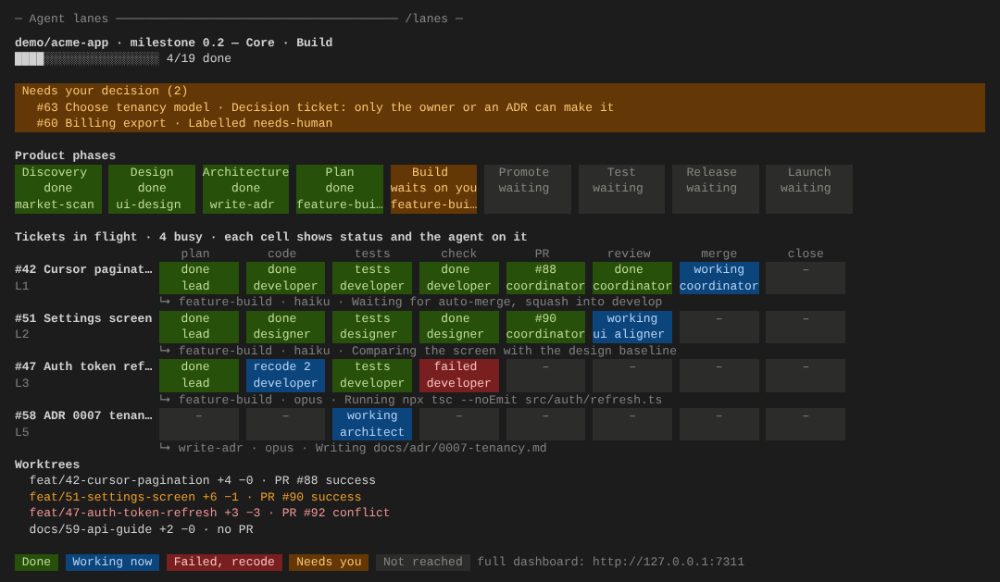

# hurray-harness

**Track every build. Lose fewer hairs.**

A live view of AI agents building your product: which lane is on which ticket, what each agent is doing right now, which skill it runs, where every worktree stands on its way to a merge, and what is waiting on you.

It works with any harness and any agent tool (Claude Code, Cursor or anything that can run a command or send JSON), reads GitHub and git without ever writing to them, and runs entirely on your own machine.


## What you see

| Section | Shows |
|---|---|
| **Needs your decision** | Decisions your harness raises, issues labelled for a person or blocked, and green PRs into an approval branch such as `main`. Each one also raises a desktop notification. |
| **Product phases** | Discovery to Launch, the skill your harness runs in each phase, and the gate that waits on you. |
| **GitHub** | Milestone progress, board columns (click one to filter), epic progress from sub-issues, and issues with the lane and agent holding each one. |
| **Lanes: grid** | One row per ticket and one column per step: plan, code, tests and docs, check, PR and gate, review, merge, close. Each cell names the agent; recode attempts are counted. Click a cell for the skill, model, what the agent is doing now, files, time and budget. Test lanes get their own steps. |
| **Lanes: swimlanes** | The same steps on a timeline, colored by agent role, with failures in red and a "now" line. |
| **Worktrees to merge** | Every lane worktree off the base branch, commits ahead and behind, its PR, checks, conflicts, and the merge into the base. |
| **Agents and activity** | Busy and idle agents by role, and a live feed from the tool hooks. |

## Try it in one minute (no repo needed)

```bash
git clone https://github.com/Narasimhaponnada/hurray-harness.git
cd hurray-harness
npm install && npm run build
npm run demo            # starts a made-up milestone on http://127.0.0.1:7311
```

## Use it on your repo

Requirements: Node 22.13 or newer, git, and the GitHub CLI signed in (`gh auth login`).

```bash
npm link                # makes the hh command available everywhere (once)
cd ~/code/my-product    # a local clone; lanes' worktrees are found from here
hh check                # confirms git, gh and the tracker can be read
hh start                # dashboard on http://127.0.0.1:7311
```

Options: `--repo PATH` (repeatable), `--github owner/name`, `--milestone 0.2`, `--base origin/main` (default: the main checkout's branch), `--approval main` (repeatable: green PRs into it wait for you), `--refresh 60`, `--fetch` (run `git fetch` on each refresh), `--port 7311`. They can also go in `hh.config.json`; see `hh.config.example.json`.

With nothing else connected you already get the GitHub view, every worktree's path to a merge, and decisions from labels and approval PRs. Then add detail at your own pace ([docs/INTEGRATIONS.md](docs/INTEGRATIONS.md)):

- **Tool hooks.** Claude Code (`.claude/settings.json`) or Cursor (`.cursor/hooks.json`) for live activity per ticket.
- **Your harness.** Put `hh step` in front of the commands it runs, or post events in the [event contract](docs/EVENTS.md), for the full lane grid with agents, skills and recodes.

```bash
hh step --ticket 42 --lane L1 --step check --agent developer -- npm test
```

## In any terminal

```bash
hh watch               # live and full screen; views take turns every 2 minutes
hh watch --rotate 90   # your own interval in seconds (or HH_ROTATE, or rotateSeconds in hh.config.json; 0 = off)
hh watch --once        # print everything once, for scripts and CI logs
```

To keep it small, the decisions stay on top while two views take turns in the space below, so nothing is ever more than one interval away. The footer says what is showing and what comes next (`now · flow in 1:24`). Keys: `n` Now, `f` Flow, `b` both, `r` resume rotating, `↑↓` scroll, `q` quit. Data refreshes every 2 seconds in both views. It works in any terminal (Cursor, VS Code, iTerm, tmux) and fits its width.

**Now** shows what is happening and who is doing it:
- the phase strip, with a **Skills running** line under it, for example `feature-build ×3 (coordinator L1, ui aligner L2, developer L3)`;
- the ticket grid, with each cell's status and agent;
- under each running ticket, a `↳` line with the skill, model, time on the step, budget meter, and what the agent is doing now;
- the idle agents, on one line.


**Flow** shows how the work moves and where each lane stands on merging:
- swimlanes, one row per lane, with each step a bar colored by agent role and failures in red;
- each lane's row ends with its PR state: `✓ merging`, `· behind 1`, `✗ conflict`, `no PR yet`;
- under each lane, a `└` line for its local worktree: branch, ahead and behind the base, clean or uncommitted changes, the last commit, and its way into the base.


## Inside Claude Code: always on screen

Install the plugin once, at the prompt of a Claude Code session:

```
/plugin install hurray-harness --marketplace Narasimhaponnada/hurray-harness
```

Answer `y` to add the marketplace and pick a scope (user, for every session). With the hub running (`hh start`), every session then shows:

- **A status line,** always visible, for example `lanes · Build · 4 busy · 2 need you · 4/19 done`.
- **A band above the prompt** whenever something needs you, with a toast when a new decision appears. **Hide** dismisses the band until the next new decision.
- **A lanes pane beside the chat** (`/lanes`). What needs you stays on top. Below it, the same **Now** and **Flow** views take turns every `HH_ROTATE` seconds (default 120). **Now** and **Flow** buttons pin one; **Rotate** resumes.



It reads the hub at `http://127.0.0.1:7311`. Set `HH_URL` to point it elsewhere.

**Status line only, no plugin.** Add this to `~/.claude/settings.json`:

```json
{ "statusLine": { "type": "command", "command": "hh status" } }
```

`hh status` prints the same one line, so it also works in tmux or a shell prompt.

## How it works

```
agent tools ─┐                    ┌─ web dashboard (live, Server-Sent Events)
harness ─────┼─▶  local hub  ─────┤
git ─────────┤   SQLite log       └─ desktop notifications
GitHub (gh) ─┘   127.0.0.1:7311
```

- **Read-only on GitHub.** GraphQL queries through `gh` with your own sign-in. No token is stored.
- **Read-only on git.** `worktree list`, `rev-list` and `status`. It never checks out, merges or deletes anything.
- **Status, not content.** The hub keeps the action, file path or command line, never prompts, file contents or tool output.
- **Local only.** It listens on 127.0.0.1 and refuses writes from web pages on other sites.
- **Append-only log.** Events are kept 14 days in `~/.hurray-harness/events.db`. Each event carries who, where and which run, so a team server can merge everyone's logs later.

## Development

```bash
npm run dev        # hub in demo mode from source
npx vite           # dashboard with hot reload on :5173, proxied to the hub
npm test           # unit and API tests
npm run typecheck
```

The code is laid out as follows:

| Path | Contents |
|---|---|
| `src/shared` | The event contract, validation, and the reducer from events to what the dashboard draws |
| `src/hub` | Server, store, git, tool hooks, decisions, demo mode |
| `src/hub/trackers` | One adapter per tracker |
| `web` | The dashboard (React) |
| `claude-code-plugin` | The Claude Code plugin: status line, band and lanes pane (`claude plugin test claude-code-plugin`) |

Plans for GitLab, Jira, the editor extensions and the team view are in [docs/ROADMAP.md](docs/ROADMAP.md).
