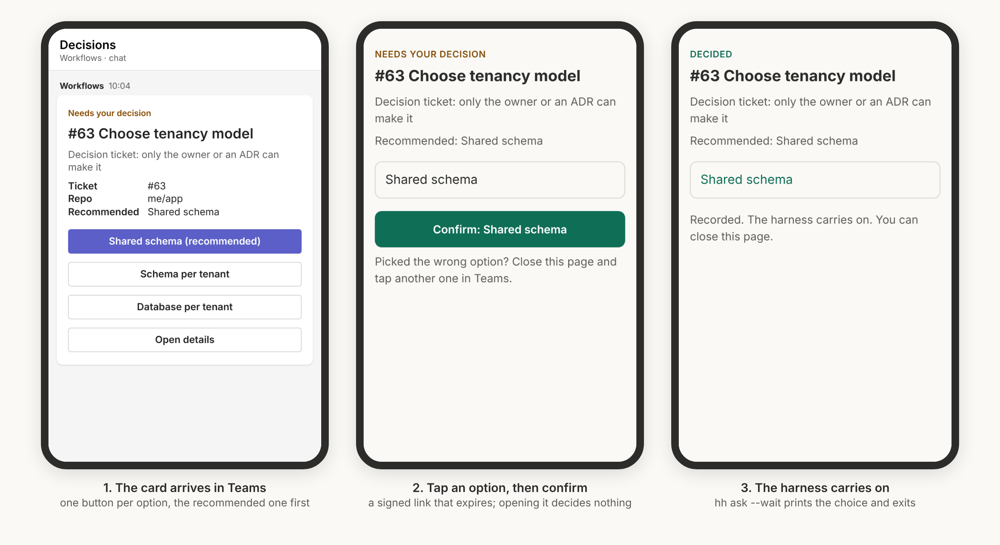

# Decisions on your phone, through Microsoft Teams

When the harness needs a person, hurray-harness posts a card to Microsoft Teams. You tap an option on your phone and confirm it, and the harness waiting on that decision carries on with your choice.



<sub>The card is drawn with Microsoft's Adaptive Cards renderer. Inside Teams it looks the same, in Teams' own fonts and colors.</sub>

## How it works

```
harness ──hh ask --wait──▶ hub ──card──▶ Teams Workflows webhook ──▶ your phone
   ▲                        ▲                                          │ tap an option
   │ prints the choice      │ records it                               ▼
   └────────────────────────┴──── decision receiver ◀── tunnel ◀── confirm page
```

1. Your harness opens a decision with options: `hh ask "Pick the database" --option Postgres --option SQLite --wait`.
2. The hub posts an Adaptive Card to a Teams **Workflows** webhook. The card has one button per option.
3. Each button opens a **signed link** to the decision receiver, a small server on your machine reached through a tunnel. The link names one decision and one option, and it expires after 24 hours.
4. Opening the link shows a confirm page; it decides nothing, so a link preview cannot answer for you. Tapping **Confirm** records the choice.
5. `hh ask --wait` prints the choice and exits 0, and the harness branches on it. A short "Decided" card follows in Teams.

The first answer wins: you can answer from Teams, the dashboard or the terminal (`hh answer`), and any later tap only shows what was decided.

## Why links and not buttons inside the card

Cards posted through a Workflows webhook cannot send a button press back to your machine, because that needs a Teams bot. Links work on every phone without a bot, an Azure subscription or a premium Power Automate licence. The cost is one extra tap, on the confirm page.

## Set it up (about 10 minutes)

### 1. Create the Teams webhook

Microsoft has retired the old "Incoming Webhook" connector, so use **Workflows**:

1. In Teams, open the chat or channel where the cards should arrive. For alerts on your phone, a chat suits best; you can also use a channel you follow.
2. Open **Workflows**. In a channel it is under the `…` menu. Otherwise open the Workflows app and go to Templates.
3. Choose the template **Post to a chat when a webhook request is received** (or **Post to a channel when a webhook request is received**).
4. Sign in, pick the chat or channel, and choose **Add workflow**.
5. Copy the URL Teams shows. Treat it like a password: anyone who has it can post into that chat.

Private channels do not take Workflows posts yet; use a chat or a standard channel.

### 2. Expose the receiver to your phone

The receiver listens on `127.0.0.1:7312` and serves only the two answer routes, so it is the only part a tunnel exposes. The dashboard and the event API stay on your machine.

| Option | Command | Notes |
|---|---|---|
| **Cloudflare quick tunnel** (simplest) | `hh start --tunnel` | Needs `cloudflared` on PATH. The URL changes every time the hub starts, so links in older cards stop working. |
| **Cloudflare named tunnel** | `cloudflared tunnel run …`, then `--public-url https://hh.yourdomain.com` | A fixed address; needs a domain on Cloudflare. |
| **Microsoft dev tunnels** | `devtunnel host -p 7312 --allow-anonymous`, then `--public-url <its URL>` | A fixed address once you create a persistent tunnel. |
| **No tunnel** | leave `publicUrl` out | Cards arrive with the options listed and no buttons. You answer on the dashboard or with `hh answer`. |

### 3. Start the hub with Teams on

Put the settings in `hh.config.json`, which git ignores:

```json
{
  "teams": {
    "webhookUrl": "https://…logic.azure.com/workflows/…",
    "tunnel": true
  }
}
```

Or use environment variables or flags instead:

```bash
export HH_TEAMS_WEBHOOK='https://…'
hh start --tunnel                      # or: --public-url https://hh.yourdomain.com
hh teams test                          # sends a sample card; check your phone
```

### 4. Ask from your harness

```bash
choice=$(hh ask "Pick the database" \
  --option Postgres --option SQLite --recommend Postgres \
  --why "ADR-004 and ADR-007 disagree" --ticket 63 \
  --wait --timeout 3600 --default Postgres)

if [ "$choice" = "Postgres" ]; then …; fi
```

| Flag | Meaning |
|---|---|
| `--option` | One choice, repeat for each (up to 6) |
| `--recommend` | Marks that option as recommended on the card |
| `--why`, `--ticket`, `--url`, `--lane`, `--repo` | Context shown on the card and the dashboard |
| `--id` | A stable id, so asking again replaces the earlier question rather than adding one |
| `--wait` | Block until answered, then print the choice |
| `--timeout N` | Give up after N seconds: exit code 3, or use `--default` |
| `--default X` | On timeout, record X as the answer (via `timeout`) and print it |

Exit codes: `0` answered, `1` no hub, `3` timed out, `4` the decision was closed without an answer.

A harness that sends JSON instead can post `decision.open` with `decision.options`, then poll `GET /api/decisions/<id>` until `status` is `answered`. See [EVENTS.md](EVENTS.md).

## Settings

| Setting | Default | Meaning |
|---|---|---|
| `teams.webhookUrl` | none | The Workflows URL. Also `HH_TEAMS_WEBHOOK` or `--teams-webhook` |
| `teams.publicUrl` | none | Where your phone reaches the receiver. Also `HH_PUBLIC_URL` or `--public-url` |
| `teams.tunnel` | `false` | Start a Cloudflare quick tunnel and use its URL. Also `--tunnel` |
| `teams.receiverPort` | `7312` | The receiver's local port. Also `--receiver-port` |
| `teams.notify` | `all` | `all` also sends tracker decisions (labels, approval PRs) as cards with an "Open details" link; `harness` sends only decisions your harness opens |
| `teams.linkHours` | `24` | How long an answer link stays valid |

## Security

- **What leaves your machine:** the decision's title, why, recommendation, options, ticket number and repo name go to Microsoft Teams. Prompts, code and tool output never do.
- **Links are signed.** Each one carries an HMAC-SHA256 signature made with a key kept in `~/.hurray-harness/teams.secret` (readable only by you). A link cannot be changed to pick another option or another decision. Delete the file to void every link sent.
- **Links expire** after 24 hours by default, and once a decision is answered no link can change it.
- **Opening a link decides nothing.** Only the Confirm button on the page does, so link previews and scanners cannot answer for you.
- **The tunnel exposes only the receiver,** never the dashboard or the event API, and the receiver answers nothing but `/d/<link>` and `/health`.
- **Who answered is not known.** Teams does not tell the receiver who opened the link, so anyone you forward a card to can answer it. Keep the cards in a chat only you, or your team, can see.

## Troubleshooting

| Symptom | Check |
|---|---|
| `hh teams test` says the webhook answered 4xx | The workflow was turned off or deleted; copy a fresh URL from the Workflows app |
| The card arrives without buttons | No `publicUrl`: start with `--tunnel` or set `--public-url` |
| "This link is not valid" | The hub's key changed, or the link was cut off when copied |
| "This link has expired" | Older than `linkHours`; answer on the dashboard, or ask again |
| A tapped link does not load | The tunnel is down or its URL changed after a restart; use a named tunnel for a fixed address |
| No notification on the phone | Notifications for that chat or channel are muted in Teams; for a channel, set it to show all activity |
